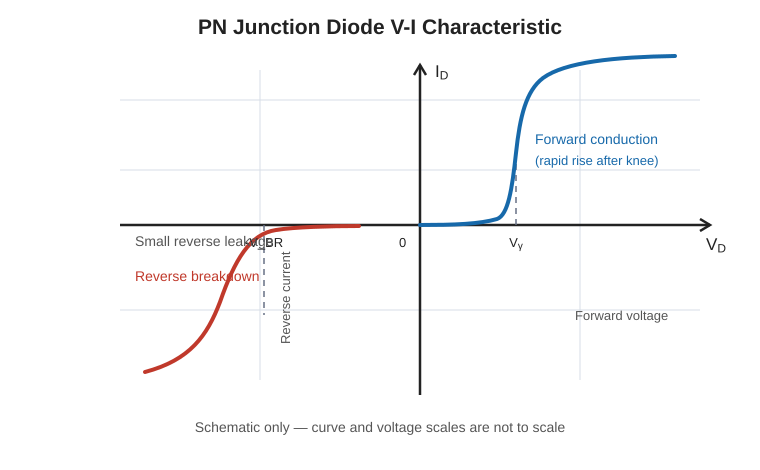

# 3. Biasing and V-I characteristics

Let $V_D$ be the voltage from the diode anode (P side) to cathode (N side), and let $I_D$ be positive in the forward direction.

## Forward bias

Connect the P side to the more positive supply terminal and the N side to the more negative terminal. The applied field opposes the junction field, reducing the depletion width and barrier. A substantial current flows once the applied voltage is sufficient; the familiar 0.7 V (silicon) and 0.3 V (germanium) values are useful circuit approximations, not exact switching thresholds.

## Reverse bias

Connect the P side to the more negative supply terminal and the N side to the more positive terminal. The applied field reinforces the junction field, widening the depletion region. Only a small reverse current normally flows, mainly due to minority carriers, until breakdown is reached.

## Characteristic regions

- **Forward region:** Current rises rapidly with forward voltage.
- **Reverse leakage region:** A small reverse current flows before breakdown.
- **Breakdown region:** Reverse current rises sharply. A conventional diode may be damaged if the current is not limited. A suitably designed Zener diode can operate here within its ratings.

## V-I characteristic graph

The graph is schematic and not to scale. Forward current rises rapidly after the knee voltage; reverse current remains small until the reverse breakdown voltage.

The idealized diode current-voltage relation is the Shockley equation:

$$
I_D = I_S\left(e^{V_D/(\eta V_T)}-1\right)
$$

where $I_S$ is the reverse saturation current, $\eta$ is the ideality factor (typically between 1 and 2), and $V_T=kT/q$ is the thermal voltage. At room temperature, $V_T$ is approximately 25.9 mV. The equation is a useful model, but real devices have limits such as series resistance and breakdown.

## Navigation

- **Next topic:** [Ideal and practical diode models](04-ideal-and-practical-diode-models.md)
- **Related topics:** [PN junction and depletion region](02-pn-junction-and-depletion-region.md), [Ideal and practical diode models](04-ideal-and-practical-diode-models.md), [Diode resistance](05-diode-resistance.md), [Zener and avalanche breakdown](08-zener-and-avalanche-breakdown.md), [Worked examples](09-worked-examples.md)
- [Back to Unit I index](../Unit-01.md)
